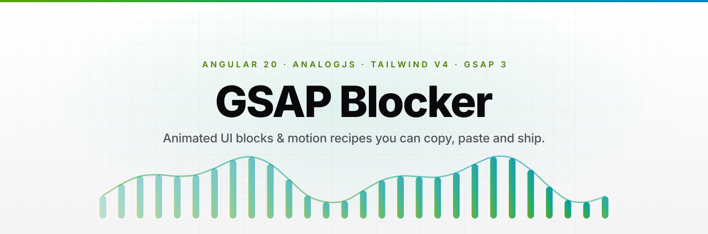
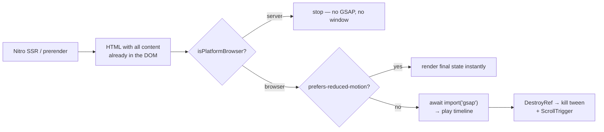
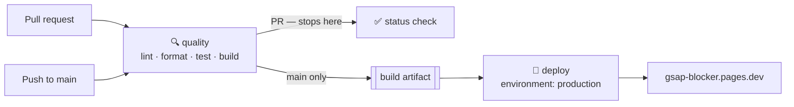

<div align="center">

<picture>
  <source media="(prefers-color-scheme: dark)" srcset=".github/assets/banner-dark.svg">
  <source media="(prefers-color-scheme: light)" srcset=".github/assets/banner-light.svg">
  
</picture>

<h3>25 animated UI blocks · 9 motion recipes · SSR-safe by default</h3>

<p>
  Production-ready landing-page sections and reusable GSAP patterns for Angular.<br>
  Copy the component, paste it into your app, ship it — no runtime, no wrapper library, no lock-in.
</p>

<p>
  <a href="https://github.com/Andersseen/gsap-blocker/actions/workflows/ci.yml"></a>
  <a href="https://gsap-blocker.pages.dev"></a>
  <a href="LICENSE"></a>
  <a href="CONTRIBUTING.md"></a>
</p>

<p>
  
  
  
  
  
  
</p>

<p>
  <a href="https://gsap-blocker.pages.dev"><b>Live demo</b></a> ·
  <a href="https://gsap-blocker.pages.dev/blocks"><b>Blocks</b></a> ·
  <a href="https://gsap-blocker.pages.dev/animations"><b>Motion recipes</b></a> ·
  <a href="https://gsap-blocker.pages.dev/docs"><b>Docs</b></a> ·
  <a href="CONTRIBUTING.md"><b>Contributing</b></a>
</p>

</div>

---

## Why GSAP Blocker

Most animation libraries hand you a runtime you now have to maintain. This one hands you **components you own**.

|                                 |                                                                                                                                         |
| ------------------------------- | --------------------------------------------------------------------------------------------------------------------------------------- |
| **Copy-paste, not `npm i`**     | Every block is a single self-contained standalone component. Take the file, delete the rest.                                            |
| **SSR-safe by construction**    | GSAP is `await import()`-ed behind `isPlatformBrowser`, so nothing touches `window` during Nitro prerender or Cloudflare SSR.           |
| **Animations that respect you** | Every recipe honours `prefers-reduced-motion`, keeps content in the DOM before it animates, and never traps keyboard focus.             |
| **Modern Angular only**         | Standalone components, signals, `@if`/`@for`, `@defer`, zoneless change detection, `OnPush` everywhere. No modules, no `NgZone` tricks. |
| **Transforms only**             | Blocks animate `transform` and `opacity`, use `gsap.quickTo` for pointer-driven motion, and kill their timelines in `DestroyRef`.       |
| **Documented, not just shown**  | Each recipe ships a live demo, the full source, a step-by-step build-up, and explicit accessibility + performance notes.                |

---

## Quick start

```bash
# 1. clone & install  (Node 22+, pnpm)
git clone https://github.com/Andersseen/gsap-blocker.git
cd gsap-blocker && pnpm install

# 2. run it
pnpm start                 # → http://localhost:5173
```

Then open a block you like, hit **Copy**, and paste the component into your own Angular app. The only dependency you need on your side is `gsap`:

```bash
pnpm add gsap
```

<details>
<summary><b>Using a block in your app</b></summary>

Blocks are plain standalone components — import and place them:

```ts
import { Component } from '@angular/core';
import Hero from './blocks/hero';

@Component({
  selector: 'app-landing',
  imports: [Hero],
  template: `<app-hero />`,
})
export class Landing {}
```

The GSAP directives (`andReveal`, `andGsapFrom`, `andGsapTimeline`) are equally standalone — copy `src/shared/directives/` and import what you use.

</details>

---

## What's inside

### 🧱 Blocks — full landing-page sections

Ready-made sections, grouped by role. Browse them live at [`/blocks`](https://gsap-blocker.pages.dev/blocks).

| Category                                                                      | #   | Variants                                          |
| ----------------------------------------------------------------------------- | --- | ------------------------------------------------- |
| 🦸 [Heroes](https://gsap-blocker.pages.dev/blocks/heroes)                     | 3   | Glow · Modern · Video                             |
| ✨ [Features](https://gsap-blocker.pages.dev/blocks/features)                 | 4   | Classic grid · Cards · Zig-zag list · Bento       |
| 💳 [Pricing](https://gsap-blocker.pages.dev/blocks/pricing)                   | 4   | Table · Simple cards · Comparison · Enterprise    |
| 💬 [Testimonials](https://gsap-blocker.pages.dev/blocks/testimonials)         | 4   | Marquee · Masonry grid · Focus · Avatars          |
| ▶️ [CTA](https://gsap-blocker.pages.dev/blocks/cta)                           | 4   | Centered · Split · Email capture · Feature image  |
| 🦶 [Footers](https://gsap-blocker.pages.dev/blocks/footers)                   | 4   | Multi-column · Interactive hover · Mega · Minimal |
| ♾️ [Infinite marquee](https://gsap-blocker.pages.dev/blocks/infinite-marquee) | 1   | Seamless logo/word ticker                         |
| 🏔️ [Parallax scroll](https://gsap-blocker.pages.dev/blocks/parallax-scroll)   | 1   | Layered ScrollTrigger parallax                    |

### 🎬 Motion recipes — the patterns behind the blocks

Each recipe is a teaching artifact: live demo, full source, step-by-step build-up, and the a11y/perf reasoning. Browse them at [`/animations`](https://gsap-blocker.pages.dev/animations).

| Recipe                                                                                   | Category       | Level          | GSAP surface                   |
| ---------------------------------------------------------------------------------------- | -------------- | -------------- | ------------------------------ |
| [Stagger Reveal](https://gsap-blocker.pages.dev/animations/stagger-reveal)               | Reveal         | `beginner`     | `gsap.from` · stagger          |
| [Spotlight Card](https://gsap-blocker.pages.dev/animations/spotlight-card)               | Interaction    | `beginner`     | `gsap.to` on CSS variables     |
| [Scroll Reveal](https://gsap-blocker.pages.dev/animations/scroll-reveal)                 | Scroll         | `intermediate` | ScrollTrigger · scrub          |
| [Text Split Reveal](https://gsap-blocker.pages.dev/animations/text-split-reveal)         | Text           | `intermediate` | `gsap.from` · per-word stagger |
| [Magnetic Button](https://gsap-blocker.pages.dev/animations/magnetic-button)             | Interaction    | `intermediate` | `gsap.quickTo`                 |
| [Disappearing Features](https://gsap-blocker.pages.dev/animations/disappearing-features) | Features       | `intermediate` | ScrollTrigger · timeline       |
| [Swap Column Features](https://gsap-blocker.pages.dev/animations/swap-column-features)   | Layout         | `intermediate` | ScrollTrigger · pinning        |
| [Card to Modal](https://gsap-blocker.pages.dev/animations/card-to-modal)                 | Shared element | `advanced`     | FLIP-style timeline            |
| [Sticky Cards](https://gsap-blocker.pages.dev/animations/sticky-cards)                   | Scroll         | `advanced`     | ScrollTrigger · pin · scrub    |

---

## How the animations stay SSR-safe

GSAP is a browser-only library, and this site is server-rendered on Cloudflare. The directives resolve that with a single rule: **nothing animation-related is imported until the browser asks for it.**



Reveal on scroll:

```html
<section andReveal>Fades in when it enters the viewport</section>
```

Animate on mount:

```html
<div andGsapFrom [from]="{ y: 24, opacity: 0, duration: 0.8 }">
  Animated content
</div>
```

Both directives are inert on the server, no-op under `prefers-reduced-motion`, and clean themselves up on destroy.

---

## Tech stack

| Layer          | Choice                        | Why                                                                      |
| -------------- | ----------------------------- | ------------------------------------------------------------------------ |
| Framework      | **Angular 20**                | Standalone components, signals, zoneless change detection                |
| Meta-framework | **AnalogJS 1.15**             | Vite dev server, file-based routing, Nitro SSR/SSG                       |
| Styling        | **Tailwind CSS v4**           | CSS-first config, semantic design tokens, dark mode                      |
| Animation      | **GSAP 3.13** + ScrollTrigger | The industry standard — lazy-loaded, never bundled into the server build |
| Testing        | **Vitest 3** + jsdom          | Same Vite pipeline as the app                                            |
| Hosting        | **Cloudflare Pages**          | SSR at the edge via `_worker.js`, ISR route rules                        |

---

## Project structure

```text
src/
├── app/
│   ├── pages/               # AnalogJS file-based routes (*.page.ts)
│   │   ├── (home).page.ts   #   → /
│   │   ├── blocks/          #   → /blocks/*
│   │   ├── animations/      #   → /animations/*
│   │   └── docs.page.ts     #   → /docs
│   ├── layout.ts            # Shell (navbar + footer + router outlet)
│   └── app.config.ts        # Providers, zoneless, view transitions
├── blocks/                  # 26 copy-paste landing-page sections
├── components/              # Site chrome + recipe presentation layer
│   └── animation-demos/     # Live demo per motion recipe
├── data/                    # Categories, features, recipe metadata
├── shared/
│   ├── directives/          # SSR-safe GSAP directives
│   ├── services/            # Theme, smooth scroll
│   ├── interfaces/          # Typed models
│   └── utils/motion.ts      # prefers-reduced-motion helper
├── main.ts                  # Browser bootstrap
├── main.server.ts           # SSR render entry
└── styles.css               # Tailwind entry + design tokens
```

<details>
<summary><b>File-based routing rules</b></summary>

Any file under `src/app/pages` ending in `.page.ts` becomes a route:

| File                                    | Route                  |
| --------------------------------------- | ---------------------- |
| `(home).page.ts`                        | `/`                    |
| `docs.page.ts`                          | `/docs`                |
| `blocks.page.ts`                        | layout for `/blocks/*` |
| `blocks/heroes.page.ts`                 | `/blocks/heroes`       |
| `animations/(animations-index).page.ts` | `/animations`          |
| `[...not-found].page.ts`                | catch-all 404          |

Per-route metadata uses `RouteMeta` from `@analogjs/router`:

```ts
export const routeMeta: RouteMeta = {
  title: 'Motion Recipes',
  meta: [
    { name: 'description', content: 'GSAP patterns, the Angular way.' },
    { property: 'og:title', content: 'Motion Recipes' },
  ],
};
```

</details>

<details>
<summary><b>Theming</b></summary>

Design tokens are plain CSS custom properties, Tailwind v4 style:

```css
@theme {
  --color-background: #ffffff;
  --color-foreground: #09090b;
  --color-primary: #18181b;
}

html.dark {
  --color-background: #09090b;
  --color-foreground: #fafafa;
}
```

The theme is applied by an inline script in `index.html` **before first paint**, so there is no flash of the wrong theme. Toggle it via the navbar or `ThemeService`.

</details>

---

## Scripts

| Command             | What it does                                                      |
| ------------------- | ----------------------------------------------------------------- |
| `pnpm start`        | Vite dev server on `:5173`                                        |
| `pnpm build`        | Production build for Cloudflare Pages → `dist/analog/public`      |
| `pnpm preview`      | Build + serve through `wrangler pages dev` (real Workers runtime) |
| `pnpm test`         | Vitest, single run                                                |
| `pnpm test:watch`   | Vitest, watch mode                                                |
| `pnpm lint`         | ESLint (TS + Angular templates + a11y rules)                      |
| `pnpm lint:fix`     | ESLint with `--fix`                                               |
| `pnpm format`       | Prettier write                                                    |
| `pnpm format:check` | Prettier check (this one gates CI)                                |
| `pnpm deploy`       | Manual build + deploy to Cloudflare Pages                         |

---

## Deployment

**One target, one pipeline.** Cloudflare Pages is the only deployment target, and [`.github/workflows/ci.yml`](.github/workflows/ci.yml) is the only thing that deploys it. Production never ships code that failed a check, because the deploy job consumes the exact artifact the quality job produced.



| Trigger               | `quality` | `deploy` |
| --------------------- | --------- | -------- |
| Pull request → `main` | ✅        | —        |
| Push → `main`         | ✅        | ✅       |
| `workflow_dispatch`   | ✅        | ✅       |

### Required repository secrets

| Secret                  | How to get it                                                                     |
| ----------------------- | --------------------------------------------------------------------------------- |
| `CLOUDFLARE_API_TOKEN`  | Cloudflare dashboard → **My Profile → API Tokens**, with `Cloudflare Pages: Edit` |
| `CLOUDFLARE_ACCOUNT_ID` | Cloudflare dashboard → **Workers & Pages**, right-hand sidebar                    |

The deploy job fails fast with a clear error if either is missing.

### Manual deploy

```bash
pnpm deploy      # build + wrangler pages deploy
```

### Runtime configuration

`wrangler.jsonc` pins the Pages project, `nodejs_compat`, and the build output directory. `public/_routes.json` keeps hashed assets off the Worker so only real SSR/ISR requests are billed as invocations. ISR and prerender rules live in [`vite.config.ts`](vite.config.ts):

```ts
routeRules: {
  '/':              { prerender: true },
  '/docs':          { prerender: true },
  '/blocks/**':     { isr: 60 },
  '/animations/**': { isr: 60 },
}
```

---

## Contributing

Issues and pull requests are welcome — new blocks and new motion recipes especially.

- [Contributing guide](CONTRIBUTING.md) — setup, conventions, PR checklist
- [Code of Conduct](CODE_OF_CONDUCT.md)
- [Security policy](SECURITY.md) — how to report a vulnerability
- [Changelog](CHANGELOG.md)

Before pushing, run what CI runs:

```bash
pnpm lint && pnpm format:check && pnpm test && pnpm build
```

### Working with AI agents

[`AGENTS.md`](AGENTS.md) documents the repo conventions for coding agents, alongside optional MCP configs for Cursor (`.cursor/mcp.json`) and OpenCode (`.opencode/opencode.json`).

---

## License

[MIT](LICENSE) © [Andersseen](https://github.com/Andersseen)

<div align="center">
<br>

Built with [GSAP](https://gsap.com/) · [Angular](https://angular.dev/) · [AnalogJS](https://analogjs.org/) · [Tailwind CSS](https://tailwindcss.com/)

**If this saved you an afternoon, a ⭐ goes a long way.**

</div>
